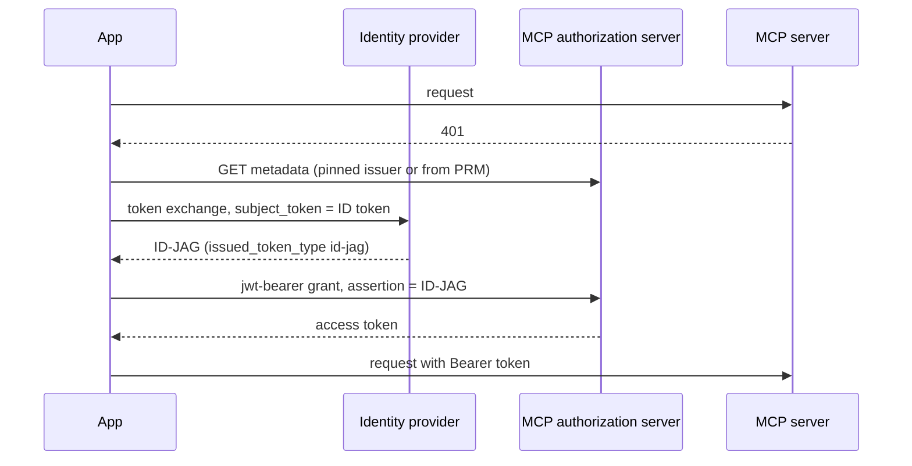

# OAuth client

## Context

MCP authorization uses OAuth 2.1 between an MCP client and the authorization server (AS) that
protects an MCP server. The client discovers the AS from Protected Resource Metadata (PRM,
RFC 9728) and AS metadata (RFC 8414 or OpenID Connect discovery), registers if needed (dynamic
client registration, RFC 7591, or a Client ID Metadata Document, CIMD), obtains a token with PKCE
(RFC 7636) and a resource indicator (RFC 8707), and retries the request.

The SDK implements the client side in `Sources/MCP/Base/Authorization/`. On the server side it
provides HTTP validators: `ProtectedResourceMetadataValidator` serves PRM and
`BearerTokenValidator` checks tokens with an application closure.

1.0.0 adds issuer checks (RFC 8414 §3.3, RFC 9207, SEP-2468),
`application_type` (SEP-837), authorization server migration (SEP-2352) and the 2025-03-26
fallback endpoints.

## Goals

- Authorization is opt-in and does not change unauthenticated code paths.
- `HTTPClientTransport` knows only a small protocol; the OAuth logic is replaceable.
- Every network step is a component that tests can replace.
- Reject metadata and responses from a server other than the one discovered (mix-up defense).
- Follow a resource that moves to another AS without a restart.

## Design

### Layers

```swift
public protocol HTTPClientAuthorizer: AnyObject, Sendable {
    var maxAuthorizationAttempts: Int { get }
    func validateEndpointSecurity(for endpoint: URL) throws
    func authorizationHeaders(for url: URL, method: String) throws -> [String: String]
    func handleChallenge(statusCode: Int, headers: [String: String], endpoint: URL,
                         operationKey: String?, session: URLSession) async throws -> Bool
    func prepareAuthorization(for endpoint: URL, session: URLSession) async throws  // default no-op
}
```

`HTTPClientTransport(endpoint:authorizer:)` calls, for each POST and before opening the GET
stream: `validateEndpointSecurity`, `prepareAuthorization` (errors ignored), then, after the
`requestModifier`, sets the headers from `authorizationHeaders` for the final URL and method
(DPoP proofs sign both). It passes the headers of every response, with the request URL, to
`didReceiveResponse` (default: nothing). On 401 or 403 it calls `handleChallenge` and retries
while the result's `retry` is `true` and fewer than `maxAuthorizationAttempts` attempts were
made; a retry the result marks `isDPoPNonceRetry` (a `use_dpop_nonce` challenge) does not count,
and a second one fails the request. The authorizer classifies the challenge, not the transport:
the default of the `sentAuthorization` variant reads it with `DefaultOAuthWWWAuthenticateParser`.
An error from `validateEndpointSecurity`, `authorizationHeaders` or `handleChallenge` fails the
request as `MCPError.transportError(error)`, except a `CancellationError`, which is thrown as is,
and a 401 or 403 that is not retried fails it as `transportError(HTTPStatusError)`.

`OAuthAuthorizer` is the built-in implementation, configured with `OAuthConfiguration`:

| Setting | Default |
|---|---|
| `grantType` | `.clientCredentials`; or `.authorizationCode`, `.jwtBearer` |
| `authentication` | required: `.clientSecretBasic`, `.clientSecretPost`, `.none(clientID:)`, `.privateKeyJWT` |
| `retryPolicy` | 3 authorization attempts, 2 scope step-ups |
| `endpointOverrides` | none; PRM URL, AS issuer, token endpoint, resource |
| `authorizationRedirectURI` | random loopback `http://127.0.0.1:<port>/callback` |
| `clientName`, `applicationType` | `"mcp-swift-sdk"`, inferred |
| `accessTokenProvider` | none; supplies an external token after discovery |
| `assertionProvider` | none; the JWT of the `.jwtBearer` grant |
| `dpop` | none (Bearer); `DPoP(privateKey:)` or `DPoP(key:)` (any `DPoPSigningKey`, e.g. Secure Enclave) binds tokens to a P-256 key |
| `authorizationDelegate` | none; presents the authorization URL |
| `proactiveRefreshWindowSeconds` | 60 |

### Components

| Component | Visibility | Default |
|---|---|---|
| `TokenStorage` | public | `InMemoryTokenStorage` |
| `OAuthScopeSelecting` | public | `DefaultOAuthScopeSelector` |
| `OAuthWWWAuthenticateParsing` | public | `DefaultOAuthWWWAuthenticateParser` |
| `OAuthMetadataDiscovering` | public | `DefaultOAuthMetadataDiscovery` (well-known URLs, canonical resource URI, resource matching) |
| `OAuthURLValidating` | internal | `OAuthURLValidator` (HTTPS or loopback, private IP checks, redirect URI) |
| `OAuthDiscoveryFetching` | internal | `OAuthDiscoveryClient` |
| `OAuthTokenRequesting` | internal | `OAuthTokenEndpointClient` |
| `OAuthClientRegistering` | internal | `OAuthClientRegistrar` |
| `OAuthAuthorizationCodeFlowing` | internal | `OAuthAuthorizationCodeFlow` |

The public convenience initializer takes the public components. The internal initializer takes
all of them; tests use it.

`OAuthAuthorizer` is a class marked `@unchecked Sendable`. The transport runs each POST in its own
task, so calls overlap: every mutable property is behind a lock, and `handleChallenge` and
`prepareAuthorization` run one at a time through `AsyncGate`. One authorizer serves one resource.

### Challenge handling

401:

`handleChallenge` and `prepareAuthorization` run through `AsyncGate`, one at a time. The token
a request was sent with is the one in its `Authorization` header: `HTTPClientTransport` passes it
through `handleChallenge(statusCode:headers:endpoint:operationKey:sentAuthorization:session:)`
(an `HTTPClientAuthorizer` requirement whose default calls the method without it; there the
stored token is read before waiting). When another challenge replaced it meanwhile, the request
retries with the new token. A waiter whose task is cancelled leaves the gate's queue and throws
`CancellationError`. Every mutable property is read and written under a lock.

The authorizer counts the challenges that ran to the end and keeps the error of the last one. A
challenge that waited while another ended with an error, and finds no unexpired token, throws
that error instead of running the same flow again: one prompt for an authorization the user
cancelled. A cancelled challenge is not counted.

0. With DPoP, a `DPoP-Nonce` header is stored for the MCP server's origin (`didReceiveResponse`
   stores it for the origin each request went to). A `DPoP` challenge
   with `error="use_dpop_nonce"` while a valid DPoP token is stored retries with the nonce and
   keeps the token; the result's `isDPoPNonceRetry` says so, read with `challengeParser`. The
   transport retries a request once for such a challenge without counting it; a second one
   fails the request.
1. If the stored token has a refresh token, the challenge names no other PRM URL, the token is
   not the one the last refresh returned, and AS metadata is cached: refresh at that AS.
   Success → retry.
2. Re-read the PRM (`refresh: true` when a token is stored). A failed re-read keeps the cached
   PRM; a PRM that no longer lists the selected AS resets the selection and clears the token.
3. If no refresh was tried yet and a token is still stored (the PRM still lists its AS), refresh
   at the selected AS, also when it is the token the last refresh returned. Success → retry. AS
   metadata that is unavailable (`OAuthMetadataUnavailable`: a network error, an unexpected
   status) or a cancelled read fails the challenge and keeps the stored tokens.
4. Clear the token. Select scopes (challenge `scope`, else `scopes_supported`).
5. If `accessTokenProvider` returns a token, store it and retry.
6. Resolve AS metadata, register if needed, run the grant, store the token with its AS.

`refreshAccessToken` refreshes only when the token's AS equals the selected AS; a token without
an AS only when an AS or token endpoint override is configured.

403 is handled only with `error="insufficient_scope"`. When another challenge stored an unexpired
token with the required scopes while this one waited, the request retries with it. Otherwise the
requested scopes are the union of the token's scopes and the challenge's. Attempts are counted
per resource, operation (the JSON-RPC method) and scope set, up to `maxScopeUpgradeAttempts`.

`prepareAuthorization` refreshes a token that expires within `proactiveRefreshWindowSeconds`,
when a refresh token and AS metadata are known. It checks the expiry again once it holds the
gate, so concurrent requests refresh once.

### Discovery order

PRM candidates, first 2xx response with non-empty `authorization_servers` wins:

1. `resource_metadata` from the `WWW-Authenticate` challenge (must be HTTPS or loopback, not a
   private IP);
2. `endpointOverrides.protectedResourceMetadataURL`;
3. `/.well-known/oauth-protected-resource<endpoint path>`;
4. `/.well-known/oauth-protected-resource`.

A candidate that answers 404 or 410 is absent. Any other outcome (network error, timeout, other
status, invalid body) makes the fetch unavailable: `OAuthMetadataUnavailable` is thrown if no
candidate succeeds, and cancellation is rethrown. Only when every candidate is absent, and only on
first discovery, a synthetic PRM names the endpoint's origin as the AS and is marked `isFallback`
(2025-03-26 servers). A PRM `resource` must match the endpoint's canonical resource
URI, else `protectedResourceMismatch`. A new challenge URL drops the cached PRM, AS selection and
AS metadata.

AS candidates: `endpointOverrides.authorizationServerURL`, else the selected AS, else the PRM's
`authorization_servers` in order. Candidates that fail validation or are private IPs are skipped
without a request. When every candidate is skipped, discovery throws the first refusal
(`insecureAuthorizationServerEndpoint` or `privateIPAddressBlocked`), not
`authorizationServerMetadataDiscoveryFailed`, except for the origin of the
[2025-03-26 fallback](#2025-03-26-fallback).
Metadata URLs per candidate:

| Issuer | URLs, in order |
|---|---|
| with path `/p` | `/.well-known/oauth-authorization-server/p`, `/.well-known/openid-configuration/p`, `/p/.well-known/openid-configuration` |
| root | `/.well-known/oauth-authorization-server`, `/.well-known/openid-configuration` |

### Issuer checks

- **AS metadata (RFC 8414 §3.3, SEP-2468).** Metadata is used only when its `issuer` matches
  the candidate it was fetched for. `OAuthIssuer.matches` is a string comparison, except that a
  root issuer may differ by a trailing slash (`https://as.example` and `https://as.example/`). If
  the only metadata found names another issuer, discovery throws
  `authorizationServerIssuerMismatch`. The old fallback that accepted another issuer is removed.
- **Authorization response (RFC 9207).** `perform` and `extractCode` take an
  `OAuthAuthorizationCodeFlow.ExpectedIssuer(issuer:isRequired:)`. The issuer is the metadata
  `issuer` (or the selected AS). An `iss` parameter must appear once and equal it
  exactly (`authorizationResponseIssuerMismatch`); a repeated or valueless `iss` is rejected. A missing `iss` is rejected only when the metadata has
  `authorization_response_iss_parameter_supported: true` (`authorizationResponseMissingIssuer`).

### Registration: DCR and CIMD

Registration runs only when `authentication` is `.none(clientID:)`, once per AS:

| Condition | Action |
|---|---|
| AS supports CIMD and `clientID` is a URL but not `https` with a path | `invalidClientIDMetadataURL` |
| `clientID` is an `https` URL with a path and the AS supports CIMD | no registration; the URL is the client id |
| `clientID` is not empty and not a URL | no registration; a pre-registered public client |
| no `registration_endpoint`, `clientID` is a CIMD URL | `cimdNotSupported` |
| no `registration_endpoint`, `clientID` is empty | `registrationInformationRequired` |
| no `registration_endpoint` otherwise | no registration |
| `registration_endpoint` present | DCR |

The DCR body has `client_name`, `application_type`, `grant_types`, `token_endpoint_auth_method`,
and for the authorization code grant `response_types: ["code"]` and `redirect_uris`. The returned
`client_id` replaces the configured one. A `client_secret_expires_at` in the past triggers a new
registration with an empty client ID. A registration that throws resets the attempt, so the next flow
registers again. That includes `cimdNotSupported` and `registrationInformationRequired`, which are
thrown without a request: the next flow checks the metadata again. A server without a registration
endpoint whose client needs none is not asked again.

`application_type` (SEP-837): `OAuthConfiguration.applicationType` when set. Otherwise `web` for
the authorization code grant with an `https` redirect URI on a non-loopback host, and `native` in
every other case (the Python SDK's default).

### JWT bearer grant and enterprise-managed authorization

`.jwtBearer` (RFC 7523 §2.1) sends `grant_type=urn:ietf:params:oauth:grant-type:jwt-bearer`, the
`assertion`, `resource` and `scope`, with the configured client authentication. The
`assertionProvider` gets an `AssertionContext`: the AS issuer (metadata `issuer`, else the selected
AS) as `audience`, the resource, the token endpoint and the requested scopes. It runs for each
token request; assertions are not cached. There is no registration for this grant. A failed
request throws `tokenRequestFailed`; nothing is retried and no other grant is tried (the
conformance `wif-no-retry` and `wif-grant-fallback` checks).

Enterprise-managed authorization (SEP-990) has two legs:



`OAuthConfiguration.enterpriseManaged` builds a `.jwtBearer` configuration whose assertion
provider asks the application for the ID token and runs `OAuthTokenExchange.exchange` with
`audience` = AS issuer and `resource` = the MCP server. `authorizationServer` sets
`endpointOverrides.authorizationServerURL`, so the PRM cannot choose the AS; its metadata must
name it as `issuer`. `nil` follows the PRM, which the conformance harness needs: it names the AS
only there.

`OAuthTokenExchange.exchange` (RFC 8693): form POST with `grant_type`
`urn:ietf:params:oauth:grant-type:token-exchange`, `subject_token`, `subject_token_type`,
`requested_token_type`, optional `audience`, `resource`, `scope`, and the client authentication.
`https` (or allowed loopback) and no private IP literal; no redirects. The response must carry
`issued_token_type` equal to the requested type (`issuedTokenTypeMismatch`); `token_type` is
not checked (`N_A` for an ID-JAG). `OAuthTokenExchange.tokenEndpoint(issuer:)` reads the token
endpoint from the issuer's metadata, with the same issuer check as AS discovery.

Comparison: the Python SDK implements leg 2 (`IdentityAssertionOAuthProvider`, configured issuer,
no PRM) and leaves leg 1 to the application; the Go SDK has both legs (`EnterpriseHandler`,
`oauthex.ExchangeToken`) and an OIDC login helper. Neither has the workload identity grant.

### DPoP (RFC 9449, SEP-1932)

`DPoPProofSigner` (internal) holds the key (`any DPoPSigningKey`: `publicKey` and
`signature(for:)`; `P256.Signing.PrivateKey` and, with CryptoKit,
`SecureEnclave.P256.Signing.PrivateKey` conform), its JWK and RFC 7638 thumbprint, and the
nonces, keyed by kind (authorization server or resource server) and origin, behind a lock.

- Proof: compact JWS, header `typ` `dpop+jwt`, `alg` `ES256`, `jwk` (EC P-256 `x`, `y`); claims
  `jti` (16 random bytes), `htm`, `htu` (scheme and host lowercased, no user information, query
  or fragment),
  `iat`, `ath` (base64url SHA-256 of the access token) on resource requests, and `nonce` when
  one is stored. The signature is the raw `r‖s` form, as for `private_key_jwt`.
- Token endpoint: `OAuthTokenEndpointClient.request(…, dpop:)` adds the proof to every grant.
  A 400 `use_dpop_nonce` with a `DPoP-Nonce` header is retried once; any `DPoP-Nonce` is
  stored. `token_type` is trimmed when decoded, so acceptance and storage see the same value;
  `DPoP` is accepted only for a request that carried a proof. The SEP-990
  identity provider exchange carries no proof: its result is an assertion, not an access token.
- Storage: a `DPoP` token is stored with `tokenType` `DPoP` and `keyThumbprint`. A `Bearer`
  answer (an AS without DPoP) is stored and used as Bearer. `authorizationHeaders` discards a
  DPoP token whose thumbprint differs from the configured key's, or any DPoP token when DPoP
  is off, expired or not; such a token's refresh token is never sent (RFC 9449 §5).
- Metadata: with DPoP, AS `dpop_signing_alg_values_supported` without `ES256` throws
  `dpopAlgorithmUnsupported`; without DPoP, PRM `dpop_bound_access_tokens_required: true`
  throws `dpopRequired`. Both are checked before registration and the grant. With DPoP, a `Bearer`
  answer for such a resource is not stored, since the resource would reject it: a grant throws
  `dpopRequired`, and a refresh returns `false`, so the challenge goes on to a full grant.
- The parser reads any scheme (`parseChallenge(scheme:from:)`); `handleChallenge` uses the
  challenge of the scheme the request was sent with (RFC 9449 §7.2), `Bearer` when it carried
  no token, else the other one, for `resource_metadata`, `scope` and `error`. A
  `resource_metadata` missing from it is taken from the other challenge. A `use_dpop_nonce`
  retry needs a stored DPoP token bound to the configured key.

Comparison: the Python and Go SDKs declare the DPoP metadata fields only.

### PKCE and the authorization code grant

- The AS metadata must list `S256` in `code_challenge_methods_supported`; a missing list or one
  without S256 throws.
- The verifier has 64 characters from the RFC 7636 unreserved set, drawn without modulo bias.
- The authorization URL carries `response_type=code`, `client_id`, `redirect_uri`, `state` (a
  UUID), `resource`, `code_challenge`, `code_challenge_method=S256` and `scope`.
- With an `authorizationDelegate`, the delegate presents the URL and returns the redirect URL.
  Without one, the flow sends a GET without following redirects and reads `Location`. The
  delegate, like `accessTokenProvider`, runs under the gate: it must not send requests through the
  transport it authorizes, since they would wait for the challenge it is part of.
- `extractCode` checks the redirect base (scheme, host, port, path), `state`, `iss`, then reads
  `code`.
- Every token request carries `resource`.

### Authorization server migration (SEP-2352)

- A 401 with a stored token refreshes first, and re-reads PRM when the refresh is refused or the
  refreshed token is rejected again. After that re-read, a refreshed token is refreshed again when
  the PRM still lists its AS.
- If the selected AS is no longer listed, the selection and AS metadata are reset and the stored
  token is cleared, unless `endpointOverrides.authorizationServerURL` configures the AS: the
  override decides the AS whatever the PRM lists.
- `authorizationHeaders` clears a stored token whose AS differs from the selected one.
- A refresh token is used only at the AS that issued it.
- Registered credentials are bound to `registrationIssuer`. When the AS changes, authentication
  returns to the configured value and registration runs again at the new AS.
- Pre-registered credentials (anything other than `.none`) are kept, as in the Python SDK.

### 2025-03-26 fallback

When every PRM candidate is absent, the synthetic PRM is `isFallback`. If every AS metadata URL
is then absent too (404 or 410), or the origin is refused as an AS candidate (loopback `http`, a
private IP), and no AS override is set and the grant is not `.jwtBearer`, `OAuthAuthorizationServerMetadata.defaultEndpoints(issuer:)`
supplies `/authorize`, `/token` and `/register` at the origin, with S256. Each endpoint is
validated when it is used, so a refused origin still works with a `tokenEndpoint` override.

### URL safety

The MCP endpoint, discovery URLs and AS endpoints must be HTTPS or loopback HTTP. A challenge's
PRM URL, AS candidates, the authorization endpoint and the token endpoint are rejected when the
host is a private or link-local IP literal (`isPrivateIPHost`). Host names are not resolved, so
DNS rebinding is not covered. The redirect URI is validated before the flow starts.

## Alternatives considered

- **Accept AS metadata with a different issuer.** The previous code did. It allows an AS mix-up,
  and SEP-2468 forbids it. Removed.
- **Normalized `iss` comparison.** RFC 9207 requires simple string comparison. Only the metadata
  check allows the root trailing slash, as Python's `issuers_match` does.
- **Reset all credentials on AS change.** Rejected for pre-registered credentials: the
  application configured them on purpose. Registered credentials are reset because they belong
  to the old AS.
- **Always `native`.** Rejected: OpenID Connect Dynamic Client Registration limits `native`
  clients to custom-scheme or loopback redirect URIs, so an `https` redirect on a public host
  belongs to a `web` client.
- **An actor for `OAuthAuthorizer`.** Not done: the protocol's synchronous `authorizationHeaders`
  would become `async`. A lock per property plus a gate for the async flows gives the same
  guarantees without changing the protocol.
- **Keep `authorizationHeader(for:) -> String?` and add the proof elsewhere.** Rejected: a DPoP
  proof signs the method and URL, and a second header needs a second return value. The new
  requirement returns all headers; the major version allows the break.
- **Enable DPoP from metadata alone.** Rejected: the key must be persisted with the tokens, which
  only the application can do, so DPoP is opt-in (`dpop`).

## Open questions

- A missing `authorization_endpoint` throws `tokenEndpointMissing`.
- `TokenStorage` holds one token, so one authorizer serves one resource.
- DPoP: only ES256; tokens from `accessTokenProvider` are Bearer only.
- No OpenID Connect sign-in helper produces the ID token for `enterpriseManaged` (the Go SDK has
  `PerformOIDCLogin`).
